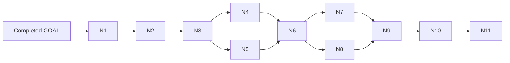

# Roadmap: full native Windows fish functionality

## Target and status

**Status: proposed implementation plan. None of N1–N11 is marked complete by this document.**
The six phases in [GOAL.md](GOAL.md) remain the completed, deliberately narrow
batch prototype; this roadmap extends that goal without rewriting its evidence.
The identifiers below are proposed acceptance requirements, not existing test names
or a claim that those tests have passed.

The target is the complete portable fish language and user experience on native
Windows: scripting, functions, pipes/redirection, persistent state, interactive
editing, completion, history, shipped tools and a distributable product. Reuse the
existing evaluator and algorithms. Do not implement a second shell, require a
POSIX compatibility runtime, or call a successful compile full feature parity.

**Exact POSIX parity is impossible.** The three excluded contracts remain excluded.
Other OS-dependent features require explicit native semantics, not fabricated Unix
state. Full completion means every component, builtin option and shipped asset has
a verified native implementation, a tested optional dependency, or an explicitly
justified platform-inapplicable contract. Ordinary missing portable features cannot
be relabeled platform-inapplicable to make the roadmap green.

The initial product target stays `x86_64-pc-windows-msvc`. ARM64 is a separate
architecture extension, not a prerequisite for x64 feature parity. Before N1 closes,
record the supported Windows versions/filesystems/terminal hosts, minimum Rust/SDK,
and release feature configurations. ConPTY's availability alone is not proof that
every host/version is supported.

## Current baseline and next priority

The prototype already has checked native text boundaries, real inherited standard
streams, native cwd/environment import/export, selected builtins and sequential
foreground `.exe` launch. Preserve its positive regression coverage and permanent
exclusion checks. As features land, replace superseded prototype rejection tests
with positive behavior tests; do not require newly supported features to keep failing.
A fresh planning smoke ran the actual debug executable with variable expansion and
arithmetic and observed `native Windows` followed by `42`. The full baseline test
results are recorded in GOAL.md; they were not all rerun for this planning task.

Implement **N1, then N2, then N3 first**. They turn the prototype into a useful
noninteractive shell. In particular, files and pipes must work before enabling
command substitution, arbitrary sourced code or startup scripts that depend on them.
N2 includes the asynchronous ownership/runtime foundations needed by later phases;
N5 is not the first place to invent process completion or worker wakeups.

## Permanent exclusions and native semantic decisions

| Contract or boundary | Roadmap decision |
|---|---|
| POSIX `fork()` | No snapshot/return-twice implementation and no post-fork Windows backend. Execute shell code in the existing evaluator and explicitly create children. |
| Same-PID POSIX `exec`/`execve()` | Keep the `exec` decorator unsupported. Spawn/wait/exit and CRT `_exec` are not process-image replacement and will not be advertised as it. |
| POSIX `fg`/`bg`, stops and controlling-terminal pgroups | Keep the existing `fg`/`bg` unsupported contract. Provide real native `&`, `jobs`, `wait` and `disown`; do not rename a wait into foreground reattachment. No `SuspendThread`/`ResumeThread` substitute. A future hosted-terminal reattachment feature would need its own approved contract. |
| Signals and cancellation | Console Ctrl events, cooperative evaluator cancellation and explicit forced termination are distinct operations. No arbitrary POSIX signal delivery or synthetic stopped/signal state. |
| Native process status | Preserve raw DWORD exits and the prototype mapping: 0–255 unchanged, other native exits map to 1. A separately defined cancellation outcome must not be inferred just from a high-bit exit code. |
| Numbered descriptors | Preserve logical fish descriptor syntax and ordering internally. Standard streams map to native handles. Extra descriptors can be inherited only through a tested child-specific protocol; arbitrary native programs do not share a universal POSIX fd table. |
| Paths, identity and permissions | Preserve fish quoting and case-sensitive local variables. Use native path/name and ACL/identity services; never invent UID/GID/mode bits. Preserve strict rejection of lone UTF-16 surrogates unless a separately tested reversible native-name codec replaces it. No lossy aliases. |
| FIFOs and resource limits | Named pipes are not POSIX pathname FIFOs. Job Object quotas are not all `rlimit` categories. Implement real applicable workflows and diagnose unavailable operations rather than report successful enforcement. |
| Third-party programs | Fish executes installed native tools; it does not make Linux programs exist. Core startup/editing must not require coreutils, WSL, MSYS, Cygwin or `/bin/sh`. Optional integrations must declare and check their real dependencies. |

API rationale and primary references are in [windows-api-reference.md](windows-api-reference.md).
In particular, Job Objects are containment/accounting, not terminal job control;
Ctrl-Break is not targeted Ctrl-C; and a running child's inherited stdin cannot be
generically replaced after launch.

## Delivery order and dependencies

| Phase | User-visible delivery | Suggested branch topic |
|---|---|---|
| [N1](GOAL_01.md) | Native navigation, discovery and filesystem expansion | `platform/windows/paths-discovery` |
| [N2](GOAL_02.md) | Streaming pipelines, redirects and capture infrastructure | `platform/windows/streaming-io` |
| [N3](GOAL_03.md) | Complete batch language, functions and portable builtins | `platform/windows/batch-parity` |
| [N4](GOAL_04.md) | Real config startup, autoload and persistent user state | `platform/windows/persistent-state` |
| [N5](GOAL_05.md) | Cancellation, asynchronous jobs, events and accounting | `platform/windows/process-supervision` |
| [N6](GOAL_06.md) | Usable native interactive editor and terminal lifecycle | `platform/windows/interactive-reader` |
| [N7](GOAL_07.md) | Completion, suggestions, pager and editing feature parity | `platform/windows/interactive-parity` |
| [N8](GOAL_08.md) | Native tool/script interoperability and platform services | `platform/windows/native-interop` |
| [N9](GOAL_09.md) | Complete shipped asset, help and localization coverage | `platform/windows/assets-localization` |
| [N10](GOAL_10.md) | Installable, relocatable native release | `platform/windows/native-release` |
| [N11](GOAL_11.md) | Full compatibility, security and quality release gate | `platform/windows/parity-closure` |

N4 and N5 can proceed independently once N3 closes. N7 and N8 can proceed
independently after N6; N8's noninteractive adapter work can start after N3/N5,
but its interactive-child gate still requires N6. Use stacked branches and explicit
interfaces for shared services, not competing rewrites of the same backend.

## N1 — Native filesystem, cwd, discovery and globs

**Owns:** `src/path/windows.rs`, `src/wutil/`, `src/fs.rs`, `src/env/`,
`src/expand.rs`, `src/wildcard.rs`, filesystem portions of `cd`, `pwd`, `path`,
`realpath`, `test`, `command` and `type`; checked identity codecs.

### Delivery

- Extend the existing services to relative paths, drive roots, drive-relative
  resolution, UNC, long/extended paths and supported reparse points. Make each
  namespace policy explicit; do not blindly prepend `\\?\` or lowercase paths.
- Implement logical/physical cwd, CDPATH and consistent relative opens/child cwd.
  Avoid process-global cwd races and assumptions that a directory handle is `fchdir`.
- Implement PATH search and an executable classification/precedence policy shared by
  launch, `command`, `type`, tests, highlighting and completion. Initially enable
  native executable providers only; N8 adds script providers without changing the
  search rules. Do not let an earlier disabled `.cmd` candidate hide a valid `.exe`.
- Restore glob traversal, metadata/file identity and executable predicates using
  native filesystem behavior, including per-directory case policy and link loops.
  Use Rust filesystem APIs where sufficient; Win32 metadata/reparse APIs where needed.
- Preserve PATH list/export collision rules and reserved Unicode/byte provenance.
  Permission and identity predicates must report native meaning or explicit
  unavailability, never guessed Unix credentials. N8 closes platform-specific options.
- Refresh the coverage ledger with current native modules/crates/assets and a named
  phase owner for every unsupported builtin/subcommand/option and every executable
  CLI option in all three binaries; retain the old audit counts as historical,
  not as current coverage proof.

### Mandatory exit gates

- **N1-PATHS — integration:** real files/directories with Unicode, spaces, roots,
  relative/drive-relative/UNC and long paths; logical versus physical `cd`, junction
  cycles, case-sensitive directories, deleted/renamed cwd, access denied and missing
  leaf. Assert identity and failure behavior rather than one slash spelling.
- **N1-DISCOVERY — e2e:** PATH order, no accidental cwd search, extension precedence,
  disabled script providers, export changes and cache invalidation. Lookup and actual
  launch agree; a marker proves a rejected candidate never executes.
- **N1-GLOB — unit/integration:** recursive/hidden-file globs, no-match policy,
  Unicode/reserved names and cancellation/expansion limits. Prove no replacement
  aliases for invalid bytes/NUL or selected unsupported native names.

## N2 — Streaming I/O, handle graphs and runtime ownership

**Owns:** `src/io_windows.rs`, `src/fds_windows.rs`, `src/redirection.rs`,
`src/exec_windows.rs`, `src/proc.rs`, native worker/monitor/wakeup services and
`src/threads/`; shared input adapters.

### Delivery

- Replace the empty native I/O-chain representation with real typed endpoints,
  logical descriptor maps, ordered dup/close/open actions and owned pipe lifetimes.
  Implement input, append, noclobber, merge, block redirects and documented null-device
  redirection. Keep shell virtual devices separate from real path identity.
- Restore the shared worker/debounce machinery without Unix masks/atfork. Provide
  native completion/wakeup registration, stable registration identity, cancellation
  and remove-and-drain ownership. Callbacks enqueue work; they do not run the parser.
- Own live child process handles and completion records until consumers finish;
  separate these from cached language-level wait results. Add minimal interruptible
  waits now so capture, watchers and later jobs have a real common foundation.
- Use overlapped-capable pipes where cancellation/readiness is required, with explicit
  buffer/OVERLAPPED lifetime. Choose bounded pumps or completion mechanisms according
  to endpoint needs, not a fixed `WaitForMultipleObjects`-sized global registry.
- Launch pipeline consumers/producers with correct scheduling and explicit handle
  inheritance. Prefer existing deferred internal producers/buffering semantics;
  evaluator work stays on the main thread. Do not launch one stage and wait before
  starting the next, or hold consumers suspended while an internal producer blocks.
- Add bounded capture infrastructure and correct input buffering without overreading
  the next `read` command. Do not seek pipes. On evaluation completion, finish capture
  without waiting for descendant-held writer EOF: cancel/drain pending reads and
  preserve already-available output at the defined completion boundary. Retain
  byte-exact redirected data and incremental valid-Unicode console output.
- Preserve numbered descriptor syntax, but diagnose extra-fd inheritance to children
  lacking a supported bridge. No cast from pointer-width HANDLE to `RawFd`.

### Mandatory exit gates

- **N2-STREAM — integration/e2e:** real external→external, builtin→external,
  external→builtin and builtin→builtin pipelines; simultaneous large stdout/stderr
  exceeding pipe capacity; slow consumers; exact binary bytes; bounded memory and EOF.
  A producer/consumer acknowledgement barrier must prove bytes arrive before the
  producer completes, not merely after complete-output buffering or spooling.
- **N2-REDIRECT — unit/integration:** append/noclobber, dup ordering, merged streams,
  closed endpoints, block redirects, explicit native-null handling and supported
  extra-fd bridges. Assert rejected higher-fd contracts before child side effects.
- **N2-LIFETIME — integration:** partial spawn/open/registration failure, abandoned
  readers, early exit, interrupted capture and concurrent launch. Assert cleanup of
  every owned child/handle, no unintended inheritance and no completion-after-free.
  Function/block mixed pipelines are additional N3 gates, not falsely claimed here.

## N3 — Full batch language, functions, scripts and portable builtins

**Owns:** native executable startup, parser/evaluator/expansion/function/event
modules, builtin registry/shared input, `src/re.rs`, PCRE2 integration,
`fish_indent`, trace, parser profiling and the noninteractive reader seam currently
used by `source` (`reader_read`/`read_ni`), extracted/reused without waiting for N6.

### Delivery

- Restore all portable syntax/control flow: `while`, `switch/case`, negation,
  functions/return, break/continue, scopes, assignments and nested evaluation.
- Implement bounded command substitution and its exact splitting/newline/status/
  cancellation semantics on N2 capture. Enable functions/blocks throughout pipelines.
- Support script-file and stdin execution, `source`/`.` and `eval` with correct argv,
  filename, line, scope and return context. Keep explicit `-N` for these execution
  modes until N4 restores normal configuration startup. Preserve fish source grammar
  for Windows paths; do not add a second command language.
- Restore the complete portable builtin families and existing options/aliases,
  including `string`, `argparse`, `contains`, `count`, `random`, loop helpers,
  `builtin`, `:`, `[` and portable `status` queries. Filesystem predicates use N1;
  active terminal/process/platform-specific options remain owned by later phases.
- Build/link the same PCRE2-32 engine under MSVC; preserve Unicode offsets, captures
  and replacements rather than substituting a different regex engine.
- Implement in-memory function definitions, copies/erase/tombstones, generic and
  variable events, `emit` and `block`. Queue handlers for safe main-thread execution.
  Disk autoload/startup/save policy is N4; job events are N5; reader events are N6.
- Restore native `fish_indent` standalone/builtin behavior, noninteractive `read`,
  CLI syntax-check/feature options, trace/debug sinks and parser profile output.
  Enable declarative completion/abbreviation metadata needed by startup; active
  editor/completion operations arrive with their owning phase.

### Mandatory exit gates

- **N3-LANGUAGE — unit/e2e:** migrate portable existing language cases rather than
  invent a parallel grammar suite. Exercise recursion, all control-flow forms,
  scopes/return/error propagation, regex groups and every string subcommand.
- **N3-CAPTURE — integration/e2e:** nested substitution and functions/blocks in mixed
  pipelines; empty values versus no values, NUL-delimited operations, read limits,
  broken downstream, cancellation and scope restoration after failure. Synchronize
  a helper that exits after spawning a descendant holding stdout: substitution must
  return with available output while that descendant remains alive until the harness
  releases it. Do not make EOF from all descendants a capture-completion condition.
- **N3-SCRIPTS — e2e:** Unicode/space filenames, UTF-8/BOM/CRLF policy, stdin EOF,
  source argv/return/source diagnostics and syntax errors before affected effects.
  Run formatter overwrite/check modes and trace/profile output to real files;
  assert write failures and no trace interference with command stdout/status.

## N4 — Configuration, autoload, history and universal variables

**Owns:** `src/env/`, `src/env_dispatch/windows.rs`, `env_universal_common.rs`,
`universal_notifier/`, `src/history/`, `src/autoload.rs`, function persistence and
mandatory startup assets in `share/config.fish`/`etc/`.

### Delivery

- Define Windows config/data/cache roots through known-folder services, with
  documented HOME/XDG overrides and user/admin/vendor precedence. Do not hide Unix
  directory assumptions in shipped startup functions.
- Restore normal batch startup without mandatory `-N`; make `-N` actually skip
  configuration and imply private-history behavior. Implement conf.d precedence/
  masking, login/private modes, startup profiling and repeatable `-C/--init-command`.
  Execute configuration, then init commands, then requested batch/script execution;
  `-N` skips configuration, not init commands. Port usable bootstrap assets without
  coreutils. Interactive execution of the same startup sequence arrives in N6.
- Implement on-disk function/completion autoload and invalidation, embedded/disk
  precedence, function saving and variable dispatch hooks.
- Implement universal variable storage/notifications and history formats, locking,
  merge/deletion/vacuum, session/private mode and compatibility with valid old files.
- Use same-volume transactions, Windows sharing/ACL semantics and recovery rules.
  `ReplaceFileW` alone does not establish POSIX rename or power-loss durability.
  Watch parent directories for replacement; overflow/lost events trigger rescan.
  Cancellation must drain registrations before buffers/handles are released.

### Mandatory exit gates

- **N4-STARTUP — e2e:** normal/-N/login/private startup, explicit root overrides,
  config precedence/masking, shipped bootstrap and autoload invalidation. Assert
  configuration → repeated init commands → requested execution ordering, argv/status,
  `-N` interaction, no-execute suppression of effects and startup profile output.
  Clean first run must not invoke an unavailable Unix utility.
- **N4-SHARING — multiprocess integration:** independent shells concurrently update,
  erase and merge universal variables/history, including active readers and export
  changes. Assert defined conflict policy, notification and no corruption/lost
  acknowledged updates; private mode leaves no persistent history.
- **N4-RECOVERY — integration:** deterministic barriers for crashes during save,
  truncated/corrupt files, denied/replaced/locked files, watcher overflow, config
  directories with restrictive ACLs and supported remote storage. State exactly
  what crash consistency was tested; do not claim untested power-loss guarantees.

## N5 — Cancellation, asynchronous jobs, events and accounting

**Owns:** `src/exec_windows.rs`, `src/proc.rs`, `src/proc_status_windows.rs`,
`src/job_group.rs`, `src/wait_handle.rs`, `src/signal_windows.rs`, event/timer services
and `jobs`/`wait`/`disown`.

### Delivery

- Expose asynchronous native jobs and complete pipelines on N2's live-handle/wait
  services. Track stable job identity, PID reuse, cached completion and exactly-once
  process/job events. Implement `wait -n` and waits after active job removal.
- Default background stdin to a readable native `NUL` endpoint unless explicitly
  redirected. It must not accidentally borrow interactive input. This cannot stop
  an arbitrary child deliberately reopening `CONIN$`; do not promise containment of
  hostile input access or later generic stdin replacement.
- Add safe console-control callbacks, cooperative evaluator cancellation and explicit
  native child/group termination policy. No allocation, locks or parser execution
  from unsafe control-callback contexts. Distinguish Ctrl-C, targeted Ctrl-Break
  where supported, and abrupt termination; never silently escalate to forced kill.
- Define the exact cancellation status/pipestatus contract before enabling handlers,
  separately from preserved raw DWORD exit mapping. Test request, ignored request,
  acknowledged cancellation and unrelated high exit codes as different transitions.
- Use per-job containment only where its lifecycle fits `disown`. Do not enable
  kill-on-close for jobs promised to survive disown/shell exit. Assignment failure
  must also clean up an unassigned suspended child, not only existing object members.
  Never terminate an enclosing CI/host Job Object.
- Restore process/job/exit handlers, shutdown warnings and elapsed/CPU/resource
  reporting with documented scope and units (`GetProcessTimes`, applicable Job
  Object accounting). Do not fabricate unavailable `rusage` fields or signal state.

### Mandatory exit gates

- **N5-JOBS — multiprocess e2e:** background pipelines, `jobs`, multi-target/`-n`
  waits, already-exited cached children, PID reuse, exactly-once events and disown
  surviving shell exit under the declared policy.
- **N5-CANCEL — integration/console e2e:** cancel long native work and blocked
  pipe/evaluator work, preserve unrelated jobs, handle ignored events explicitly,
  and verify raw/status/pipestatus for each termination origin. GUI/detached/foreign
  console children must receive only supported, documented operations.
- **N5-ACCOUNT — unit/integration:** real CPU child, builtin, concurrent pipeline,
  completed child and nested-child scope. Assert units, accumulation without double
  counting, and explicit unavailable resource categories.

## N6 — First usable native interactive reader

**Owns:** native startup, `src/reader/`, `src/input/`, `src/terminal.rs`,
`src/termsize.rs`, `src/screen.rs`, editing/key services, `bind`, `commandline`,
interactive `read`, `breakpoint` and `fish_key_reader`.

### Delivery

- Enable normal interactive startup and prompt/input/evaluation cycles using N4
  state and N5 lifecycle services. Port the required first-prompt/default-binding
  asset subset now; do not wait for N9 while invoking missing `mkdir` or `/bin/sh`.
- Choose and document console/VT input transport, Unicode decoding, output capability
  detection, resize, cursor reporting and structured key identity. Reuse editor and
  screen models. ConPTY is a test/host transport, not a POSIX tty implementation.
- Restore modes through RAII on normal return, child completion, error and orderly
  cancellation. Disable fish-owned VT input protocols before a foreground child
  can read, including bracketed paste and any negotiated enhanced keys; restore them
  when the editor resumes, including failed launch/cancellation, and deactivate them
  on shell exit. Pause the editor during child input ownership so the two cannot race.
- Deliver actual editing/navigation, multiline editing, core bindings/modes,
  bracketed paste and selection/clipboard integration with an explicit policy for
  pasted newlines. Completion/pager refinements are N7; unsupported actions must not
  be silently advertised as working.
- Restore interactive `read`, native key reader and nested `breakpoint` scope/context.
  Existing `fg`/`bg` exclusions remain; changing window focus is not a substitute.

### Mandatory exit gates

- **N6-EDITOR — native console/ConPTY e2e:** type/edit/submit multiple commands,
  UTF-16 split input/non-BMP/combining text, multiline paste without implicit
  execution, resize during editing, EOF and Ctrl-C prompt recovery.
- **N6-CHILD — console e2e:** real console/TUI child reads keys/paste without fish's
  protocol envelopes and changes modes; fish resumes a functional editor with its
  protocols restored. Cover failed launch, orderly cancellation and shell exit.
  Background default stdin reaches EOF and cannot steal ordinary typed commands;
  explicit background input redirection still works.
- **N6-TOOLS — integration/e2e:** native `fish_key_reader`, interactive `read`,
  bindings and breakpoint interaction, invalid/nonterminal input, nested scopes and
  mode restoration after errors. Observe real console state, not a captured echo.

## N7 — Interactive feature parity

**Owns:** completion/highlighting/autosuggestion workers, pager/screen/width/color,
abbreviations, reader search, binding modes and terminal protocol negotiation.

### Delivery

- Restore dynamic and programmable completion, wrappers/conditions, argument/path/
  command discovery and completion autoload using the same N1/N8 resolver policy.
- Restore autosuggestions, history search/navigation, abbreviation functions/regex,
  pager navigation, syntax highlighting, indentation and commandline editing actions.
- Restore all default/vi/hybrid bindings and required function assets for their
  delivered actions. Preserve Unicode character versus display-cell boundaries.
- Bound/cancel background work. Stale completion/highlight/history results must not
  overwrite a newer command line; completion wakes the reader through N2 services.
- Negotiate colors, key protocols, clipboard/selection and terminal features by
  capabilities; redirected output must not become terminal control data by accident.

### Mandatory exit gates

- **N7-COMPLETE — unit/console e2e:** real files/native commands, evaluated completion
  conditions, escaping, wrappers, caching and cancellation of obsolete work.
- **N7-EDIT — console e2e:** history/private-session search, suggestions, regex and
  function abbreviations, pager, vi/emacs/hybrid transitions and commandline actions.
- **N7-RENDER — unit/console e2e:** exact editor state and observed screen after
  combining/emoji/wide characters, resize, color changes, background output and
  terminal negotiation. Record host/font/protocol conditions rather than assuming
  a UTF-16 code unit is a cell.

## N8 — Windows tool interoperability and native platform services

**Owns:** central command providers, path/permission predicates, environment adapters,
resource-limit/platform builtin options and corresponding shipped helper protocols.

### Delivery

- Add deliberate `.cmd`/`.bat` and `.ps1` providers using the N1 classification rules.
  Interpreter/provider selection is explicit; `.fish` scripts use fish, not a generic
  `cmd /c`/PowerShell fallback. Address `.com`, shebang and unsupported executable
  formats with documented classification rather than optimistic launch retries.
- Specify each provider's argument model and accepted input domain. Batch parsing
  cannot be assumed to preserve arbitrary native argv; reject unrepresentable input
  before effects. Disable autorun/profile behavior where appropriate. Never splice
  untrusted arguments into a command string without a proven provider-specific policy.
- Keep commands' bytes/Unicode, environment, cwd and raw status across Windows
  toolchains, including npm-style command shims and explicit interpreter launches.
- Close native ACL/access/identity/device predicates and applicable quotas/time/
  process/account/network helpers. Capability-check unavailable legacy tools instead
  of assuming WMIC or Unix utilities. `ulimit` options without honest native
  enforcement must fail explicitly and appear in the semantic-difference ledger.
- Implement `psub` file-backed operation and its cleanup; separately classify FIFO
  mode. Completion protocols requiring fd 8/9 or sockets need tested adapters, not
  a claim that arbitrary HANDLE inheritance creates POSIX descriptors.

### Mandatory exit gates

- **N8-ARGV — integration/e2e:** native, batch, PowerShell and fish scripts with
  empty/space/quote/trailing-backslash/Unicode arguments, leading dashes, `% ! ^ & |`
  metacharacters and supported newline cases. Assert literal values or explicit
  prelaunch rejection; use markers to prove no injected command executes.
- **N8-TOOLS — real-tool e2e:** pinned native Git/compiler/package-manager/Python/
  PowerShell fixtures and console tools. No PATH confusion, unexpected interpreter,
  profile execution or shell fallback; missing dependencies give useful errors.
- **N8-POLICY — unit/integration:** real ACL-denied/read-only/reparse/device cases,
  enforced native quotas, unsupported Unix predicates, file-backed `psub` lifetime,
  child-specific descriptor protocols and clean failure of unsupported variants.

## N9 — Shipped assets, help, localization and user tools

**Owns:** all `share/`/`etc/` families, embedded assets, `src/localization/`,
`src/locale.rs`, help entrypoints, Python tools and their build/generation crates.

### Delivery

- Close every shipped function, completion, prompt, theme and startup asset, not just
  the Rust binary. Replace mandatory Unix dependencies with native services/fish
  logic; preserve optional third-party integrations with explicit capability checks.
- Cover navigation/history helpers, VCS prompts, clipboard/browser/open actions,
  extraction/temp/cache helpers, migration, `funcsave`/`funced`, process facades and
  generated completions. Rejected `exec`/`fg`/`bg`/`suspend`/signal wrappers must retain
  truthful diagnostics and never dispatch a same-named unrelated executable.
- Restore locale discovery, translation catalogs/Fluent/gettext and user-visible
  Unicode formatting while preserving C numeric parsing where required. Build real
  default-feature configurations; the final product is not permanently no-default-only.
- Port native Python user tools, web configuration and manpage completion generation:
  interpreter discovery, native child paths, browser launching, loopback/auth checks,
  background generation and cleanup. Optional Python/Sphinx/gettext prerequisites
  belong to documented tool/build features, not mandatory shell startup.
- Make standalone and builtin help select the matching fish installation. Provide
  packaged documentation/help without assuming `man`, `less` or `/bin/sh` exists.

### Mandatory exit gates

- **N9-ASSETS — integration/e2e:** inventory every shipped asset as native-tested,
  optional-with-tested-dependency, or genuinely platform-inapplicable with reason.
  Exercise complete startup/default prompts/bindings outside checkout on a clean
  native PATH; parse/load all applicable definitions, then execute their critical
  dynamic paths. A parse-only check is not execution coverage.
- **N9-TOOLS — integration/e2e:** actual web configuration edits, saving/reloading
  themes/functions, generated completion precedence, absent/corrupt manpages,
  native Python version handling, loopback/auth rejection and tool shutdown/cleanup.
- **N9-LOCALE — unit/e2e:** non-English catalogs, missing-translation fallback,
  decimal/grouping locales, Unicode help/paths and all three binary help entrypoints
  with a different fish earlier on PATH. No silent optional dependency downgrade.

## N10 — Native release and installation

**Owns:** manifests/build scripts, all workspace build/generation tools, native CI,
release packaging, executable resources and installed data/documentation layout.

### Delivery

- Produce a relocatable x64 ZIP distribution first, with `fish.exe`, `fish_indent.exe`,
  `fish_key_reader.exe`, required native libraries/licenses and the selected embedded/
  installed assets. Record CRT/PCRE2 architecture and deployment requirements.
- Support reproducible native version/build metadata and runtime asset discovery;
  runtime must not locate developer source paths or use the wrong executable from PATH.
- Publish supported default/minimal feature profiles and minimum toolchain/Windows
  requirements. Developer translation/manpage/extraction/check tooling must have a
  real native entrypoint or an explicit supported build-host role, not `.sh` delegation.
- Test user-local install, upgrade and removal, preserving user state. Supply explicit
  PATH/Windows Terminal registration instructions; do not silently rewrite user profiles.
- MSI/MSIX/winget and Authenticode publication are additional distribution work, not
  implied by ZIP success. Signed artifacts require an authorized signing credential
  and trust verification; otherwise label the ZIP unsigned.

### Mandatory exit gates

- **N10-INSTALL — clean-machine e2e:** install/run/update/remove outside the checkout,
  from spaces/Unicode directories and restricted user accounts. Verify no build tools,
  POSIX runtime or accidental developer DLL is needed; user data survives upgrade/removal.
- **N10-MATRIX — native CI:** debug/release, supported feature profiles, minimum/current
  Rust, supported Windows/terminal/filesystem matrix, unit/integration/console/doctests
  and applicable workspace tools. Preserve separate Unix/MSYS gates.
- **N10-ARTIFACT — integration:** archive contents/dependencies/licenses/version and
  architecture, binary/help entrypoints, native startup and user-state location.
  Cross-compilation alone cannot establish any additional architecture's runtime support.

## N11 — Compatibility and product-quality closure

**Owns:** final coverage reconciliation, test/benchmark infrastructure, release policy,
security review, performance baselines and user-facing compatibility documentation.
This is not a bucket for unassigned implementation work.

### Delivery

- Close the complete builtin/subcommand/option/alias/CLI inventory against real tests,
  all workspace crates and every shipped asset. Every original component analysis
  must have a verified implementation destination or a justified semantic difference.
- Migrate all applicable Unix language tests to a native direct-process harness;
  preserve their behavior and original Unix suite. Translate pexpect/tmux contracts
  into native console/ConPTY tests, not skipped test files. Audit every platform skip.
- Stress handle/process/thread cleanup, cancellation, concurrent state saves,
  notification overflow, disconnect, denied resources and invalid inputs. Review
  interpreter injection, inherited-handle disclosure, config trust and state ACLs.
- Benchmark real startup, child launch, large pipelines/globs, history merges and
  interactive edit/completion latency on recorded hardware/filesystem/output sinks.
  Adopt numeric budgets from recorded N1/N6 baselines before optimization; no
  post-hoc thresholds or comparison of discarded pipe output with rendered ConPTY.
- Verify keyboard-only and screen-reader operation on named terminal/assistive-tool
  combinations, including prompt/edit/pager announcements, Unicode navigation and
  color-independent feedback. Do not imply universal UIA support without evidence.

### Mandatory exit gates

- **N11-COVERAGE — release audit:** no unassigned or silently disabled portable
  feature, unresolved supported capability, empty suite, unexplained skip or missing
  asset/crate disposition. Publish exact executed cases and the semantic-difference ledger.
- **N11-FAULTS — integration/e2e:** sustained concurrent jobs/edits/saves plus injected
  process/I/O/state failures; bounded memory and shutdown, stable handle/thread counts,
  no surviving owned children or unintended kills/disown regressions.
- **N11-QUALITY — measured/manual-assisted e2e:** adopted performance budgets pass on
  the recorded hosts; named accessibility journeys and clean-install daily workflows
  pass. Record observed limits instead of declaring universal parity.

## Complete component ownership crosswalk

The original source audit remains useful rationale, not a current support claim.
N1 refreshes its exact file inventory. New native owning files are explicitly
included in the phases above.

| Original analysis/component family | Implementation and closure owners |
|---|---|
| [01 Parser/evaluator](01-parser-and-evaluator.md) | N2 I/O/process seam; N3 language/functions/scripts/profiling; N5 cancellation; N6 debugger |
| [02 Expansion/completion/highlighting](02-expansion-completion-highlighting.md) | N1 traversal/discovery; N3 substitution; N4 autoload; N7 interactive algorithms |
| [03 Processes/jobs](03-process-execution-job-control.md) | N2 streaming launch/completion ownership; N5 asynchronous lifecycle; N8 adapters |
| [04 Signals/events/waits/limits](04-signals-events-waits.md) | N2 wakeups; N3 language events; N5 lifecycle/control/accounting; N8 applicable limits |
| [05 I/O/descriptors](05-io-redirection-file-descriptors.md) | N2 endpoints/graphs/capture; N6 terminal input; N8 child-specific protocols |
| [06 Terminal/reader/input](06-terminal-reader-screen-input.md) | N6 interactive lifecycle; N7 full editing/rendering; N11 host/accessibility closure |
| [07 Filesystem/path/globs](07-filesystem-paths-wildcards.md) | N1 path/identity/discovery; N4 durable state; N8 predicate completion |
| [08 Environment/universal variables](08-environment-and-universal-variables.md) | N1 cwd/export policy; N4 roots/storage/dispatch; N8 tool environments |
| [09 History/functions](09-history-functions-autoload.md) | N3 function core; N4 storage/autoload; N6/N7 reader integration; N9 save/edit assets |
| [10 Builtins](10-builtins.md) | N1 filesystem; N3 portable; N4 persistence; N5 jobs; N6/N7 interactive; N8 native-specific; N9 help/localization |
| [11 Text/regex/localization](11-text-regex-localization.md) | N1 checked identity; N2 byte transport; N3 regex; N6/N7 width; N9 locale/catalogs |
| [12 Runtime/concurrency](12-concurrency-and-runtime-support.md) | N2 workers/waits/ownership; N3 trace; N4 watchers; N5 control; N11 stress |
| [13 Binaries/assets](13-binaries-and-assets.md) | N3 formatter; N4 startup; N6 key reader/bootstrap; N9 all assets; N10 distribution |
| [14 Workspace crates](14-workspace-crates.md) | Explicit crate groups below; N10 build-host closure; N11 inventory audit |
| [15 Build/package/docs](15-build-packaging-documentation.md) | N9 generation/localization/help; N10 packaging; N11 release documentation |
| [16 Tests/benchmarks/CI](16-tests-benchmarks-ci.md) | Every phase adds behavioral gates; N10 matrix; N11 full migration/performance/skip audit |

### Workspace crate destinations

| Crates | Owner |
|---|---|
| `common`, `widestring`, `util`, `tempfile`, `fallback`, `wcstringutil`, `wgetopt`, `feature-flags` | N1–N3 native/shared boundaries; N11 full regression |
| `printf` | N3 complete formatting/stream behavior; N9 locale coverage |
| `color`, `widecharwidth` | N6/N7 terminal and character-cell behavior |
| `fluent`, `localization`, `gettext`, `gettext-maps`, `gettext-mo-file-parser` | N9 catalogs/runtime localization; N10 deployment |
| `build-helper`, `build-man-pages`, `gettext-extraction`, `fluent-extraction`, `xtask` | N9 generation and native tools; N10 supported build/release-host execution |

All 21 current crate directories have a destination. A host-only generator is not
excused from a documented working host path; a runtime dependency is not excused
from native execution by classifying it as tooling.

### Builtin/option closure ownership

Use the [complete builtin inventory](10-builtins.md), including `string` subcommands,
`path` subcommands, `test` predicates and `status` option families as the ledger.
Portable registry entries/aliases belong to N3; filesystem options to N1/N8;
configuration/history/universal options to N4; `jobs`/`wait`/`disown`/`time` to N5;
`bind`/`commandline`/interactive `read`/`breakpoint`/key reader to N6/N7; `_` and help
to N9. `exec`, POSIX `fg`/`bg`, arbitrary signal registrations and unavailable quota
categories remain explicit semantic differences, never fake successful entries.
Each phase enables only the options it implements and exercises, and N11 checks the
whole ledger. Pure registration is not proof of a working command.

### Executable CLI ownership

Inventory the actual argument parsers, not only the builtin registry:
[fish options](../../src/bin/fish/unix.rs), [native entry](../../src/bin/fish/windows.rs),
[formatter options](../../src/builtins/fish_indent.rs) and
[key-reader options](../../src/builtins/fish_key_reader.rs).

| Executable option family | Phase and required behavior |
|---|---|
| Fish `-c/--command`, repeated commands, script/stdin/argv/`--`, `-n/--no-execute`, `-f/--features`, `-v/--version` | N3: actual requested execution/parse-only behavior, option errors and stable version/feature results; file/stdin execution initially uses `-N`. |
| Fish `-d/--debug`, `-o/--debug-output`, `--print-debug-categories`, `-p/--profile` | N3: real diagnostic/profile sinks, category selection, errors and noninterference with stdout/status. |
| Legacy `-D/--debug-stack-frames` | N3: document an explicit retired/unavailable policy or implement real behavior; do not advertise the upstream ignored flag as a functioning stack-debug feature. |
| Fish `-C/--init-command`, `-l/--login`, `-N/--no-config`, `-P/--private`, `--profile-startup` | N4: startup ordering, init-command repeatability, private state and profile behavior; N6 repeats the gates for interactive startup. |
| Fish `--print-rusage-self` | N5: real applicable native counters/units and explicit unavailable fields; no fabricated POSIX accounting. |
| Fish `-i/--interactive` and implicit interactive startup | N6: real reader lifecycle and terminal/nonterminal selection, not a partial editor or successful no-op. |
| Fish/formatter/key-reader `-h/--help` | N9: matching installed executable and real native help delivery. |
| Remaining `fish_indent` and `fish_key_reader` flags | N3 formatter / N6 key reader: inventory every flag and exercise its actual file/stream/console behavior; N9 closes help and N10 packaging. |

N11 reconciles this completed CLI ledger; it is not the first implementation owner
for a forgotten startup flag.

## Verification and work-landing contract

1. Preserve GOAL's positive native regressions, permanent exclusion checks and relevant
   Unix gates, and rejection of capabilities that are still deferred. Each enabling
   phase replaces only its superseded negative assertions with
   real positive coverage: for example drive-relative paths in N1; pipes/redirection
   in N2; substitution in N3; universal assignment in N4; background launch in N5;
   script providers in N8. Do not merely flip an expected status or remove coverage.
   Update CI discovery/registry expectations rather than freezing prototype counts.
   Keep GOAL's historical evidence unchanged. Add deterministic owning-component unit
   tests, real filesystem/process integration and actual fish/console scenarios as
   indicated above, reusing existing behavioral cases.
2. Introduce runnable test names/commands when implementing each proposed ID; record
   expected discovery, executed/nonignored counts, toolchain, target, source revision,
   artifact and results. CI fails on a missing required ID, empty run or hidden skip.
3. Use native argument-array launches and isolated user-state roots. Bound waits,
   drain both streams, terminate/reap only owned work, and use synchronization rather
   than sleeps for race/failure cases. Add network/privileged fixtures explicitly;
   unavailable required infrastructure blocks that phase instead of silently skipping it.
4. Console tests must observe real input/output/modes; unit tests and captured echo
   cannot establish an editor. Record human-assisted terminal/accessibility checks
   separately from automated ConPTY results.
5. Extend existing owning Windows services. Do not introduce a second evaluator or
   require a wholesale `platform::*` framework rewrite. Extract shared logic where
   demonstrated; remove obsolete prototype guards/paths when their real consumers land.
6. Work in `platform/windows/<topic>` worktree branches, with one integration owner
   for shared boundaries. Commit coherent changes with WHY messages, owning tests,
   docs and actual runtime smoke evidence. Do not push unverified phase claims.
7. A phase is complete only when its declared behavior and every required gate pass.
   There is no compile-only phase completion, renamed unsupported contract or blanket
   Windows test exclusion. The product is complete only after N11 closes.

## Additional architecture/distribution tracks

After the x64 feature contract is established, ARM64 may be enabled on its own
`platform/windows/arm64` track: architecture-matching CRT/PCRE2/dependencies, actual
ARM64 Windows process/console/state tests and installed-package runs are mandatory.
An x64-emulated run or cross-compile is not native ARM64 runtime evidence.
Additional installer channels/signing similarly require explicit infrastructure and
verification; they do not excuse missing shell features or block a correctly labeled
x64 ZIP delivery.
